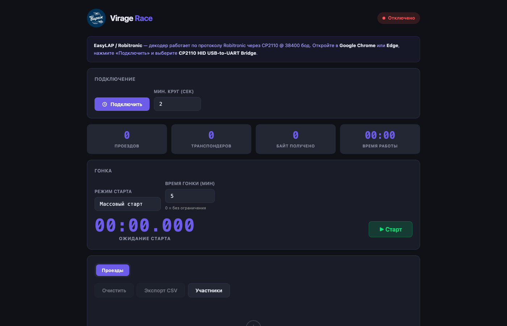
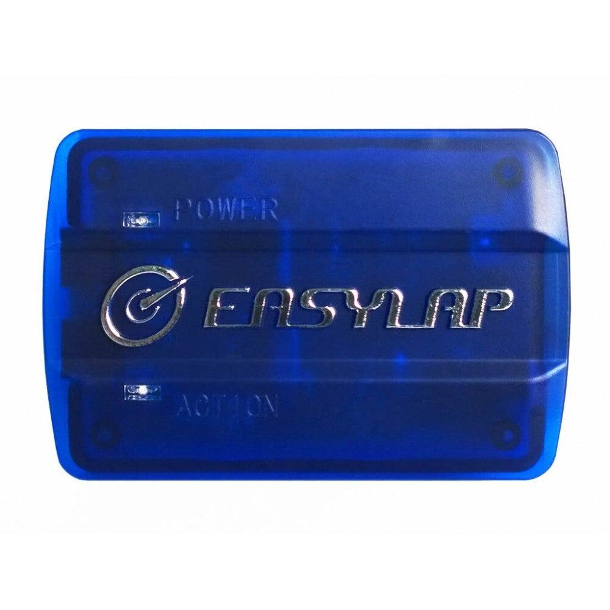
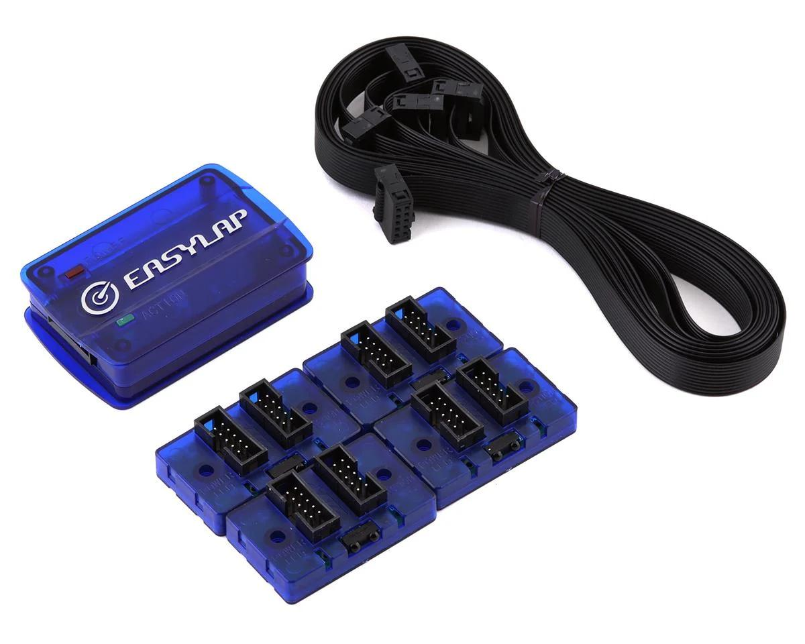

# Virage Race

[English](README.md) | Русский

Одностраничное WebHID-приложение для чтения проездов RC-транспондеров с декодеров на базе CP2110 (EasyLAP / Robitronic) и отображения статистики гонки в реальном времени.

## Что умеет

- Подключается к устройству CP2110 HID-UART напрямую из браузера (без десктопного приложения).
- Разбирает проезды и показывает их в реальном времени.
- Управляет состоянием гонки: старт, стоп, сброс.
- Считает метрики кругов по каждому транспондеру (количество кругов, последний круг, лучший круг, средний круг, общее время).
- Хранит имена транспондеров в локальном хранилище браузера.
- Содержит сырой лог и hex-дамп для диагностики.

## Поддерживаемые устройства

| Модель | Совместимость | Что это |
|---|---|---|
| EasyLap ET005 (Mini-USB) | ✅ Поддерживается | Предыдущее поколение USB-контроллера |
| EasyLap ET005 (USB-C) | ✅ Поддерживается | Современная версия контроллера |
| EasyLap EZL01 | ✅ Поддерживается | Полный комплект: контроллер и 4 ИК-приёмника |
| EasyLap EZL02 | ✅ Поддерживается | Комплект с 4 приёмниками и 4 транспондерами |

  
  

## Требования

- Google Chrome или Microsoft Edge (версия 89+).
- Включённая поддержка WebHID в браузере.
- Совместимый декодер на базе CP2110, подключённый по USB.

## Онлайн-версия

- Приложение: https://rai220.github.io/virage-race/

## Локальный запуск

Проект представляет собой один HTML-файл со встроенными CSS/JS.

1. Откройте `index.html` в поддерживаемом браузере.
2. Нажмите «Подключить» и выберите устройство CP2110 в диалоге браузера.
3. Запустите гонку и проезжайте машинами через петлю/арку.

Если прямое открытие файла в вашем окружении ограничено, раздайте папку любым статическим HTTP-сервером и откройте страницу с него.

## Структура проекта

- `index.html` — весь интерфейс и логика приложения.
- `screenshot.png` — скриншот интерфейса для README.
- `docs/` — фотографии устройств для README.

## Примечания

- Интерфейс приложения на русском языке.
- Поддержка браузеров намеренно ограничена движками с WebHID.
